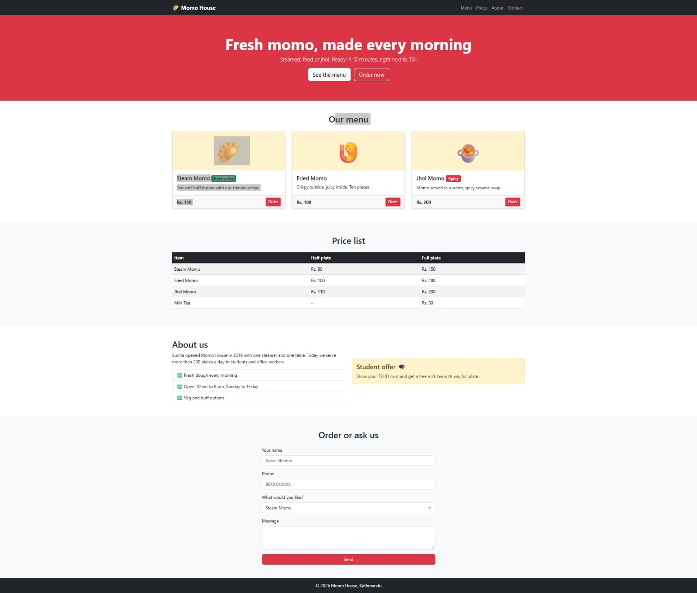

# Momo House: Bootstrap Revision

A small practice page for a momo shop, built while learning **Bootstrap**. I use this repo to revisit Bootstrap's main component and utility types: each section of the page uses a different part of the framework.

`reference_image.jpg` is the design I'm working towards.



---

## Bootstrap types used in this page

### 1. Layout: containers
| Class | What it does |
|---|---|
| `container` | Fixed-width, centered wrapper that changes width at each breakpoint |
| `container-fluid` | Full-width wrapper (100% at every screen size) |

### 2. Components
| Component | Classes used | Where |
|---|---|---|
| **Navbar** | `navbar`, `navbar-expand-lg`, `navbar-dark`, `navbar-brand`, `navbar-toggler`, `navbar-collapse`, `navbar-nav`, `nav-item`, `nav-link`, `active` | Top navigation bar; collapses into a hamburger menu below `lg` |
| **Collapse** (JS) | `collapse`, `data-bs-toggle="collapse"`, `data-bs-target="#id"` | The hamburger button opens and closes the nav links |
| **Buttons** | `btn`, `btn-dark`, `btn-warning` | Hero section buttons |
| **Cards** | `card`, `card-img-top`, `card-body`, `card-title`, `card-text` | "Our menu" item cards |
| **Tables** | `table`, `table-striped`, `table-responsive` | "Price list" section |

### 3. Flexbox utilities
| Class | What it does |
|---|---|
| `d-flex` | Turns an element into a flex container |
| `flex-column` / `flex-row` | Sets the direction of the items |
| `justify-content-center` / `justify-content-around` | Alignment on the main axis |
| `align-items-center` | Alignment on the cross axis |
| `gap-3`, `gap-4` | Space between flex items |

### 4. Spacing utilities
Format: `{property}{side}-{size}`, where `m` = margin, `p` = padding, and sizes run from 0 to 5.

| Class | Meaning |
|---|---|
| `py-5` | Padding top and bottom, size 5 |
| `p-3` | Padding on all sides, size 3 |
| `mb-3`, `mb-4` | Margin bottom |
| `mx-auto` | Auto left and right margin (centers a block) |
| `ms-auto` | Auto left margin; pushes the nav links to the right |

### 5. Colour utilities
| Class | What it does |
|---|---|
| `bg-dark`, `bg-danger`, `bg-body` | Background colours from the theme |
| `text-center` | Centers the text |

### 6. Typography
| Class | What it does |
|---|---|
| `h1` | Gives any element the size of an `<h1>` |
| `fs-5` | Font-size scale (1 = largest, 6 = smallest) |

### 7. Borders and shadows
| Class | What it does |
|---|---|
| `rounded` | Rounded corners |
| `shadow-*` | Box shadow |

### 8. Image helpers
| Class | What it does |
|---|---|
| `d-inline-block`, `align-text-top` | Lines the logo up with the brand text |

---

## Still to practise (from the reference design)
- [ ] **Badges**: `badge text-bg-success` ("Best seller"), `badge text-bg-danger` ("Spicy")
- [ ] **Card footer**: `card-footer` with `d-flex justify-content-between` for the price and Order button
- [ ] **Grid system**: `row` + `col-md-4` so the cards stack on mobile
- [ ] **Table header**: `table-dark` on `<thead>`
- [ ] **List group**: `list-group`, `list-group-item` ("About us" checklist)
- [ ] **Alert**: `alert alert-warning` ("Student offer" box)
- [ ] **Forms**: `form-label`, `form-control`, `form-select`, `btn w-100`
- [ ] **Footer**: `bg-dark text-white text-center py-3`
- [ ] Outline buttons: `btn-light`, `btn-outline-light`

---

## Project structure
```
momo-house/
├── index.html           # The page
├── css/style.css        # Custom CSS (a small reset)
├── images/              # Logo and momo photo
└── reference_image.jpg  # Target design
```

## How to run
No build step. Open `index.html` in a browser. Bootstrap loads from the jsDelivr CDN.

## Tech
- HTML5
- [Bootstrap](https://getbootstrap.com/) (CSS and JS bundle via CDN)
